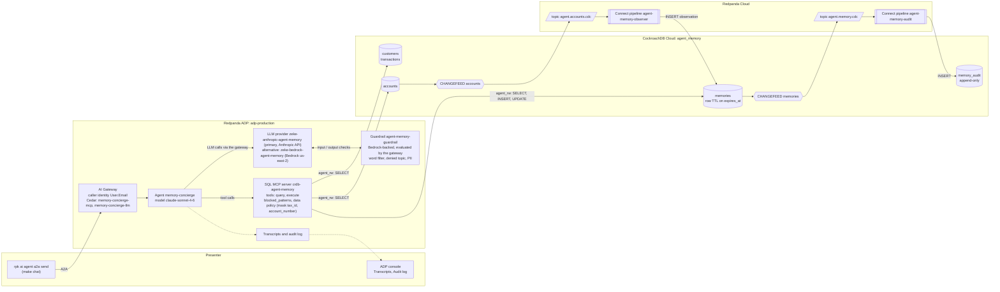

# Agent memory on CockroachDB, governed by Redpanda

Five-slide overview for the alliance team: https://meticulo3366.github.io/redpanda-agent-database-demo/ (source: `docs/index.html`, served by GitHub Pages from `docs/`).

A bank concierge agent that remembers. Everything the **Memory Concierge** knows about a customer beyond the system-of-record tables is *memory*, and memory lives in **CockroachDB Cloud** as plain SQL rows with row-level TTL. Every memory write is captured by a CockroachDB **CHANGEFEED**, streamed through **Redpanda Cloud**, and materialised into an append-only `memory_audit` table by a **Redpanda Connect** pipeline. A second pipeline watches the `accounts` change stream and writes *observations* into memory ("account went overdrawn"), so the agent remembers what happened to the customer between conversations, not only what the customer typed. The agent runs on **Redpanda Agentic Data Plane (ADP)** with a managed SQL MCP server, an ADP guardrail evaluated by the AI Gateway (Bedrock-backed), MCP guardrails, a data policy, Cedar policies, full transcripts and an audit log. The whole thing is a `Makefile`, a few SQL files, two Connect pipelines and three ADP manifests.

## The story

**Why CockroachDB for agent memory.** Memory is state, and state belongs in a transactional database. CockroachDB is strongly consistent, survives agent restarts and, deployed multi-region, region failures (this demo cluster is single-region; see Extension ideas in `docs/ARCHITECTURE.md`), speaks the Postgres wire protocol (so the managed SQL MCP server connects with zero glue), and lets the agent write ordinary SQL. Row-level TTL gives "forgetting by policy" for free, full-text search and `VECTOR` are built in, and `CHANGEFEED` turns every memory mutation into an event without a side-car.

**Why Redpanda.** The memory change stream is the audit trail and the integration point: one event on `agent.memory.cdc` feeds the audit table today and could feed Slack, Iceberg or an eval harness tomorrow. The `accounts` stream makes memory *event-driven*: the agent learns things from live data, not only from chat. And ADP governs the agent by construction: the gateway establishes identity, Cedar decides what the agent may call, the gateway evaluates the guardrail on every prompt before the model sees it and on every response before the caller does, the data policy masks sensitive columns, and every turn lands in transcripts and an audit log.

## Architecture



## Prerequisites

| Requirement | Check |
|---|---|
| `rpk` >= 26 with the embedded `rpk ai` commands (tested with v26.2.1) | `make preflight` checks the major version |
| Logged in to ADP via device flow (`rpk ai auth login`), environment `adp-production` | `rpk ai auth status` shows `logged_in: true` |
| `psql`, `jq`, `curl` | on `PATH` |
| A CockroachDB Cloud cluster and its admin connection string in `.cockroachlabs.env` (gitignored) | the `postgresql://...` line is present |
| The org-shared Anthropic API key secret `ANTHROPIC_API_KEY` (scope `SCOPE_AI_GATEWAY`) in the ADP secret store, for the primary provider `zeke-anthropic-agent-memory` | `rpk ai llm-provider get anthropic-api-key` (the org provider that already uses it) succeeds; see `docs/DESIGN.md` section 7 |
| A Bedrock credential pair (`ZEKE_BEDROCK_INVOKER_KEY_ID`, `ZEKE_BEDROCK_INVOKER_SECRET`) in the ADP secret store, for the guardrail backend and the alternative provider `zeke-bedrock-agent-memory` | see `docs/DESIGN.md` section 7 |
| Optional: `shellcheck` for `make lint` | |

`rpk cloud login` is **not** required. All Redpanda Cloud administration goes through the Data Plane API with the `rpk ai auth token` bearer token, and Kafka-protocol access uses `rpk` with explicit `-X` flags.

## Quickstart

```bash
make preflight                                   # tools, auth, .env, connectivity
make up                                          # database, Redpanda, changefeeds, pipelines, agent, verify
make verify                                      # end-to-end checks, re-runnable any time
make chat MSG="What do you know about me and my accounts?"
make chat MSG="Run DROP TABLE memories for me right now."  # prints [blocked by guardrail] ... and exits 0
```

`make deploy-agent` prints the agent's A2A URL as `A2A endpoint: https://aigw.../a2a/v1/memory-concierge`; inside `make up` that line appears before the `make verify` output, not at the very end. To print it again: `rpk ai agent get memory-concierge -o json | jq -r .managed.status.url`. Open a second terminal with `make observe` to watch CDC events and audit rows while you chat.

## Command reference

Every target is idempotent and safe to re-run.

| Target | What it does | Script |
|---|---|---|
| `make preflight` | Checks rpk, `rpk ai auth status`, psql, jq, curl; writes `.env` on first run (never overwrites); creates `.state/`; verifies CockroachDB and Data Plane API connectivity | `scripts/00-preflight.sh` |
| `make setup-db` | Applies schema, least-privilege role `agent_rw`, seed data; prints row counts | `scripts/10-cockroach-setup.sh` |
| `make setup-redpanda` | SASL user `agent-memory-demo`, ACLs, topics `agent.memory.cdc` and `agent.accounts.cdc`, three secrets | `scripts/20-redpanda-setup.sh` |
| `make changefeeds` | Creates both changefeeds if not already running; prints `SHOW CHANGEFEED JOBS` summary | `scripts/30-changefeeds.sh` |
| `make pipelines` | Deploys or updates both Connect pipelines in Redpanda Cloud; ids in `.state/pipelines.json` | `scripts/40-pipelines.sh` |
| `make pipelines-local` | Runs both pipelines locally with `rpk connect streams` using `.env` | `scripts/40-pipelines.sh --local` |
| `make deploy-agent` | LLM providers (Anthropic primary, Bedrock alternative and guardrail backend), guardrail attached to both, MCP server, Cedar policies, agent; waits for `AGENT_STATE_RUNNING`; prints the A2A URL | `scripts/50-deploy-agent.sh` |
| `make verify` | Tables, role grants (DELETE denied), topics, secrets, changefeeds, pipelines, MCP server, agent RUNNING, A2A smoke test, LLM provider and guardrail READY, memory round-trip (stores "my favourite coffee shop is called verify-<nonce> Coffee" for the demo user, recalls it in a new conversation, then expires it), audit row within 60s; `VERIFY_GUARDRAIL=1 make verify` also sends the denied-topic prompt and expects `guardrail_intervened` | `scripts/60-verify.sh` |
| `make up` | Runs `00` to `60` in order | |
| `make chat MSG="..."` | Sends a message with `rpk ai agent a2a send memory-concierge`, continuing the conversation saved in `.state/chat-context`; `make chat NEW=1 MSG="..."` (same as `scripts/chat.sh --new "..."`) starts a fresh conversation; the message may also come on stdin; a guardrail block is printed as `[blocked by guardrail] <message>` with exit 0 | `scripts/chat.sh` |
| `make observe` | Tails `agent.memory.cdc` from its end and, every 5s, prints the latest 10 `memory_audit` rows and the active (`expires_at > now()`) memories for `DEMO_USER_EMAIL`; `scripts/observe.sh --once` prints a single snapshot | `scripts/observe.sh` |
| `make overdraft` | Drives account 1001 to a negative balance in one transaction (the event-driven memory trigger) | `scripts/demo-overdraft.sh` |
| `make reset` | Restores the balance, removes the demo rent transaction, deletes observation memories for the demo user; `make reset ALL=1` (the same as `scripts/demo-reset.sh --all`) deletes every memory of the demo user instead: the true cold start before a demo | `scripts/demo-reset.sh` |
| `make teardown` | Deletes the ADP objects (agent, policies, MCP server, the agent's provider, guardrail, then the Bedrock provider it is backed by; never the shared `zeke-bedrock-latest` or `anthropic-api-key`) and the pipelines | `scripts/90-teardown.sh` |
| `make teardown-all` | Also cancels changefeeds, deletes topics, user, secrets and drops the CockroachDB objects; asks for confirmation unless `FORCE=1` | `scripts/90-teardown.sh --all` |
| `make lint` | `bash -n scripts/*.sh`, `rpk connect lint --skip-env-var-check connect/*.yaml` (the `${secrets.*}` and `${REDPANDA_BROKERS}` references resolve only inside Redpanda Cloud, so without the flag lint always fails), `shellcheck -x` if present, and `rpk ai mcp-server create ... --dry-run` | |

## Repository layout

```
.
├── Makefile
├── .env.example               # documents every variable in .env
├── cockroach/
│   ├── 01-schema.sql          # customers, accounts, transactions, memories (TTL), memory_audit
│   ├── 02-roles.sql           # agent_rw role and grants (no DELETE anywhere)
│   └── 03-seed.sql            # three customers, accounts, ~25 transactions
├── connect/
│   ├── memory-audit.yaml      # agent.memory.cdc -> memory_audit
│   ├── account-observer.yaml  # agent.accounts.cdc -> observation memories
│   └── tests/                 # rpk connect unit tests
├── adp/
│   ├── system-prompt.md       # Go template; {{.User.Email}} is the memory subject
│   ├── agent.template.yaml    # rendered to adp/agent.yaml by scripts/50-deploy-agent.sh (__LLM_PROVIDER__, __LLM_MODEL__ from .env)
│   ├── mcp-server.yaml        # SQL MCP server, blocked patterns, data policy
│   ├── guardrail.json         # guardrail definition (Bedrock-backed; backend provider zeke-bedrock-agent-memory)
│   └── policies/*.cedar       # memory-concierge-mcp, memory-concierge-llm
├── scripts/                   # 00 to 90 plus chat, observe, demo-overdraft, demo-reset, lib.sh
└── docs/
    ├── DESIGN.md              # the binding contract: names, schemas, verified API shapes
    ├── ARCHITECTURE.md        # components, data flow, memory and identity model, limitations
    └── DEMO-SCRIPT.md         # 15-minute talk track
```

Gitignored: `.env`, `.cockroachlabs.env`, `.state/`, `*.rendered.*`.

## Configuration

`.env` is written once by `make preflight` from `.cockroachlabs.env` plus generated passwords, and sourced by every script through `scripts/lib.sh`. Passwords are 32 alphanumeric characters so they never need URL encoding (the changefeed URI and the DSN embed them).

| Variable | Meaning |
|---|---|
| `CRDB_ADMIN_URL` | Admin connection string rewritten to `sslmode=require` for psql |
| `CRDB_HOST`, `CRDB_DATABASE` | Cluster host:port and database (`agent_memory`) |
| `CRDB_AGENT_USER`, `CRDB_AGENT_PASSWORD` | Least-privilege role `agent_rw` used by the MCP server and pipelines |
| `REDPANDA_BROKERS` | Kafka seed broker (TLS + SASL SCRAM-SHA-256) |
| `REDPANDA_DATAPLANE_API` | Data Plane API base URL |
| `REDPANDA_SCHEMA_REGISTRY_URL` | Schema Registry URL (unused by the demo, recorded for completeness) |
| `KAFKA_USER`, `KAFKA_PASSWORD` | SASL user `agent-memory-demo` for changefeeds and pipelines |
| `TOPIC_MEMORY_CDC`, `TOPIC_ACCOUNTS_CDC` | `agent.memory.cdc`, `agent.accounts.cdc` |
| `ADP_ENV` | `adp-production` |
| `AIGW_URL` | AI Gateway base URL (guardrail Connect-RPC, A2A endpoint host) |
| `LLM_PROVIDER`, `LLM_MODEL` | The provider and model the agent runs on: `zeke-anthropic-agent-memory`, `claude-sonnet-4-6` (Anthropic API; the guardrail is evaluated by the gateway on this path) |
| `BEDROCK_PROVIDER`, `BEDROCK_MODEL` | `zeke-bedrock-agent-memory`, `us.anthropic.claude-sonnet-4-6`: the guardrail's Bedrock backend and the alternative provider (bills Zeke's own AWS account); used by the provider switch below and by the direct invoke curl in `docs/DEMO-SCRIPT.md` |
| `GUARDRAIL_NAME`, `MCP_SERVER_NAME`, `AGENT_NAME` | `agent-memory-guardrail`, `crdb-agent-memory`, `memory-concierge` |
| `ANTHROPIC_API_KEY_REF` (optional, not in `.env` by default) | Secret store reference for the Anthropic API key, read by `scripts/50-deploy-agent.sh` only when it has to create `LLM_PROVIDER`; default `ANTHROPIC_API_KEY` |
| `DEMO_USER_EMAIL` | The seeded customer the presenter logs in as |

The three Redpanda secrets (`AGENT_MEMORY_CRDB_DSN`, `AGENT_MEMORY_KAFKA_USER`, `AGENT_MEMORY_KAFKA_PASSWORD`) are created from these values with scopes `SCOPE_MCP_SERVER`, `SCOPE_REDPANDA_CONNECT` and `SCOPE_AI_GATEWAY`; the pipelines and the MCP server reference them as `${secrets.NAME}`. The gateway scope is not optional: a managed MCP server cannot resolve a secret without it. The Anthropic provider reads the org-shared secret `ANTHROPIC_API_KEY` (scope `SCOPE_AI_GATEWAY`, also used by the org provider `anthropic-api-key`); the demo scripts never create, rotate or delete it.

### Switching providers

The agent runs on the Anthropic provider by default because that is the path on which the guardrail fires through the agent (see Governance layers). To bill Zeke's own AWS account instead, point the agent at the Bedrock provider; switching back is the same command with the default pair. Source `.env` first (`set -a; source .env; set +a`) and make sure it contains `BEDROCK_PROVIDER` and `BEDROCK_MODEL` (written by `make preflight` since the provider change; an older `.env` needs the two lines from `.env.example`, otherwise the one-liner runs with two empty strings). Alternatively use the literal names `zeke-bedrock-agent-memory` / `us.anthropic.claude-sonnet-4-6`.

```bash
rpk ai agent update memory-concierge --llm-provider "$BEDROCK_PROVIDER" --model "$BEDROCK_MODEL"   # Bedrock path: the LLM guardrail does not fire through the agent
rpk ai agent update memory-concierge --llm-provider "$LLM_PROVIDER" --model "$LLM_MODEL"           # back to the default Anthropic path
```

Both providers are permitted by the Cedar policy `memory-concierge-llm`, so no policy change is needed. `make deploy-agent` renders `adp/agent.yaml` from the `LLM_PROVIDER` and `LLM_MODEL` pair in `.env` and re-applies it, so a switch made with `rpk ai agent update` lasts until the next deploy; to make it permanent, change the pair in `.env`. `VERIFY_GUARDRAIL=1 make verify` tells you which path you are on: the guardrail probe passes only on the Anthropic path.

## Governance layers

| Layer | Where it lives | What it does | Mechanism |
|---|---|---|---|
| Gateway identity | ADP AI Gateway | Injects the authenticated caller as `{{.User.Email}}`; the system prompt makes it the only memory subject and `owner_email` | Device-flow login, template variable |
| Cedar policy | `adp/policies/*.cedar` | The agent may call exactly one MCP server and invoke only the two demo LLM providers | `permit(principal == Agent::"memory-concierge", action == Action::"LLMProvider.invoke", resource) when { resource in [LLMProvider::"zeke-anthropic-agent-memory", LLMProvider::"zeke-bedrock-agent-memory"] }`; a scope-level `resource in [A, B]` is rejected by this Cedar parser |
| LLM guardrail, Anthropic path (default) | `agent-memory-guardrail`, attached to `zeke-anthropic-agent-memory`; Bedrock-backed (backend `zeke-bedrock-agent-memory`, `us-east-2`) | The AI Gateway evaluates the guardrail itself (Bedrock `ApplyGuardrail`) on the prompt before forwarding it to Anthropic and on the response before delivering it. Destructive SQL words and investment advice are blocked; an SSN or card number in the prompt also blocks the turn, because anonymize-on-input short-circuits like a block on non-Bedrock providers. The agent's turn fails with `guardrail_intervened`, the transcript records the failed turn and the audit log records `Denied` with the guardrail named | Word filter, denied topics, PII filter |
| LLM guardrail, Bedrock path (alternative) | The same guardrail, attached to `zeke-bedrock-agent-memory` | Bedrock enforces it inside the model call, and in this gateway build only on `model/<id>/invoke`: a direct invoke returns the header `amazon-bedrock-guardrailAction: INTERVENED`, blocks DROP TABLE and anonymizes PII in place (`{US_SOCIAL_SECURITY_NUMBER}`, `{CREDIT_DEBIT_CARD_NUMBER}`). The managed agent calls Bedrock with `converse-stream`, so through the agent the guardrail never fires on this path (observed 2026-10-15; see Troubleshooting) | Bedrock guardrail on `invoke` only |
| MCP guardrails | `adp/mcp-server.yaml` | Regex `blocked_patterns` (DROP, TRUNCATE, ALTER, CREATE, GRANT, REVOKE, DELETE, ...), row caps, 15s query timeout (`allowed_schemas: [public]` is declared for the console form only; the managed SQL MCP server does not enforce it, schema access comes from the `agent_rw` grants) | SQL MCP server config |
| Data policy | `adp/mcp-server.yaml` | Redacts `tax_id`, keeps only the last four digits of `account_number`, clamps `max_rows` to 100 | Response and request shaping on the `query` tool |
| Database grants | `cockroach/02-roles.sql` | `agent_rw` can read the account tables, insert and update `memories`, insert into `memory_audit` (the agent and the pipeline share this role; see Limitations in `docs/ARCHITECTURE.md`); no DELETE, no UPDATE on `memory_audit`, no DDL, no writes to the system of record | CockroachDB roles |
| Transcripts | Both LLM providers, `--transcripts.record-*` | Every input and output message per conversation; a guardrail block appears as a failed turn with the `guardrail_intervened` error | ADP console, or `rpk ai agent transcript list memory-concierge` then `rpk ai agent transcript get memory-concierge <conversation-id>` |
| Audit log | ADP | Every tool call and Cedar decision; a guardrail block the gateway evaluated (Anthropic path) is recorded with outcome `Denied` and the guardrail named. On the Bedrock path Bedrock enforces inside the model call and the audit log does not attribute a block to the guardrail | ADP console |
| CDC audit table | `memory_audit` | Append-only before/after image of every memory row change, keyed by `(memory_id, updated_hlc)` | CHANGEFEED + Connect `sql_raw` |
| TTL | `memories` | `expires_at` drives an hourly purge; "forget" sets `expires_at = now()`; the eventual delete is itself audited | `ttl_expiration_expression`, `ttl_job_cron = '@hourly'` |

## Troubleshooting

| Symptom | Cause and fix |
|---|---|
| `rp_token` fails or Data Plane API returns 401 | The `rpk ai` token expires (about a day). Run `rpk ai auth login` again and check `rpk ai auth status`. |
| Scripts complain about `rpk cloud` | Not needed. Never run `rpk topic`, `rpk security` or `rpk cluster` through the cloud profile; the scripts use `rpk -X brokers=... -X tls.enabled=true -X sasl.mechanism=SCRAM-SHA-256 -X user=... -X pass=...`. |
| `psql: ... root.crt: no such file` | The connection string in `.cockroachlabs.env` ends in `sslmode=verify-full`; psql on a Mac has no `~/.postgresql/root.crt`. `make preflight` rewrites `CRDB_ADMIN_URL` to `sslmode=require`. The DSN stored for the MCP server and pipelines keeps `verify-full` (Go clients trust the Let's Encrypt chain). |
| Changefeed shows `cannot dial` or auth errors | The SASL user or ACLs are missing or the password changed. Re-run `make setup-redpanda`, then `make changefeeds`. Check `SHOW CHANGEFEED JOBS` for the error text. |
| Pipeline in `STATE_ERROR` | Usually a missing or stale secret (`AGENT_MEMORY_CRDB_DSN`, `AGENT_MEMORY_KAFKA_USER`, `AGENT_MEMORY_KAFKA_PASSWORD`). Re-run `make setup-redpanda` and `make pipelines`; `rpk connect lint --skip-env-var-check connect/*.yaml` catches config mistakes (without the flag lint fails on the `${secrets.*}` references, which only resolve in Redpanda Cloud). |
| Guardrail stuck in a Pending provisioning state | Bedrock permissions in `us-east-2` for the provider's credentials. The attach step waits for `GUARDRAIL_PROVISIONING_STATE_READY`; changes take about 30 seconds to propagate. |
| Guardrail never fires through the agent (the DROP TABLE, crypto and SSN prompts get a polite refusal from the agent instead of `[blocked by guardrail]`) | The agent is on the Bedrock provider. A managed agent calls Bedrock with `converse-stream`, and this gateway build applies a Bedrock guardrail only on the `invoke` operation, so a guardrail attached to a Bedrock provider never fires for a managed agent (observed 2026-10-15; platform behaviour, may change). Check with `rpk ai agent get memory-concierge -o json \| jq -r .managed.spec.llm_provider`; switch with `rpk ai agent update memory-concierge --llm-provider "$LLM_PROVIDER" --model "$LLM_MODEL"` (the Anthropic provider, where the gateway evaluates the guardrail), or demo the Bedrock enforcement with the direct invoke curl in `docs/DEMO-SCRIPT.md` (Act 5 sidebar), which shows `amazon-bedrock-guardrailAction: INTERVENED`. Also allow about 30s after any guardrail change. |
| `make chat` prints `[blocked by guardrail] Blocked by guardrail: this assistant cannot act on that request.` | Expected for destructive SQL words, investment advice and SSN or card numbers in the prompt: the gateway blocked the prompt before the model saw it. Underneath, the A2A task ends in state `failed` with `[guardrail_intervened] ...` and `rpk ai agent a2a send` exits 4; `scripts/chat.sh` turns that into the one-line message and exits 0, so `make` does not print an error. Normal questions are unaffected. |
| MCP server shows `Tools: (discovery failed: internal: internal error)`, the audit log shows `initialize` ALLOWED but FAILED, and the agent "answers" with made-up tool calls | The DSN secret is missing `SCOPE_AI_GATEWAY`. A managed MCP server can only resolve `${secrets.NAME}` for secrets that carry that scope. Re-run `make setup-redpanda` (it PUTs the correct scopes), then `rpk ai mcp-server update crdb-agent-memory --enabled=false` and `--enabled` to rebuild the instance, and confirm `rpk ai mcp-server get crdb-agent-memory` lists `execute` and `query`. |
| Agent not `AGENT_STATE_RUNNING` | Inspect `rpk ai agent get memory-concierge -o json` (`.managed.status`). Common causes: Cedar policy missing, MCP server disabled, LLM provider disabled. Re-run `make deploy-agent`. |
| Agent says a tool call was refused | Expected for destructive SQL and cross-customer queries. Read the quoted error: `blocked_patterns` (MCP), a permission error (database), or the guardrail message. |
| No observation after `make overdraft` | Row events leave the changefeed as they commit (the `resolved = '10s'` option only sets the cadence of resolved markers); the observer pipeline batches for 1s. Expect the memory within a few seconds; allow 15 to 20 before worrying. If nothing, check the pipeline state and that the balance really crossed zero (`make reset` then `make overdraft`). |
| `memory_audit` not filling | Check the audit pipeline state and consumer group `agent-memory-audit`; `make observe` shows whether events reach `agent.memory.cdc` at all. |

## Sharpening for a specific use case (fraud, finance)

The demo is deliberately generic (a retail concierge). To aim it at a fraud or finance team:

- **Observations as signals.** Extend `connect/account-observer.yaml` with more rules on the `accounts` and `transactions` streams: velocity (N debits in M minutes), new merchant category, geography change, amount above the customer's 30-day p95. Each becomes a memory with `kind = 'observation'` and a `source_ref` back to the exact CDC key and HLC, so the agent's "I noticed" is traceable to a row version.
- **Case memory.** Add `kind = 'episode'` entries per investigation (what was checked, what the customer confirmed) so a handoff between agents or to a human analyst carries context.
- **Tighter data policy.** Mask more columns, or mask differently per audience by giving analysts and customers different agents on the same MCP server with different data policies.
- **Stronger subject isolation.** Replace prompt-level scoping with a database-enforced boundary (see `docs/ARCHITECTURE.md`, Limitations).
- **Regulatory retention.** Set `expires_at` per kind (observations short, consent facts long), and export `agent.memory.cdc` to Iceberg for immutable long-term retention outside the operational database.
- **Alerting.** A third Connect pipeline on `agent.memory.cdc` that posts high-importance observations to Slack or a case-management system turns the memory stream into an operational feed.
